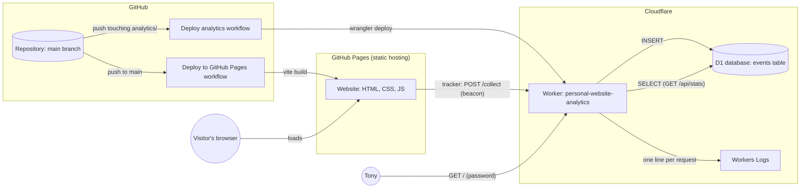

# Feature reference

Every feature built into the site, from what a visitor sees down to the code and services behind it. For
each feature it lists what it does, where it lives (HTML, CSS, JavaScript, backend, deploy), how the parts
fit together, and what to edit to change it.

- [README.md](../README.md) covers running the site locally.
- [analytics/README.md](../analytics/README.md) covers switching analytics on.
- [docs/PLAN.md](PLAN.md) is the original plan.
- [docs/CONVERSATION-LOG.md](CONVERSATION-LOG.md) is the step-by-step story of how all of this was built.

## Contents

1. [How the whole thing fits together](#1-how-the-whole-thing-fits-together)
2. [Threadline design system](#2-threadline-design-system)
3. [Fluid scaling for phones, laptops and big screens](#3-fluid-scaling-for-phones-laptops-and-big-screens)
4. [Drifting dot-grid background](#4-drifting-dot-grid-background)
5. [Page structure and content](#5-page-structure-and-content)
6. [Hero "On this thread" strip](#6-hero-on-this-thread-strip)
7. [Interactive timeline](#7-interactive-timeline)
8. [Motion and micro-interactions](#8-motion-and-micro-interactions)
9. [Moving between sections](#9-moving-between-sections)
10. [Reduced motion and accessibility](#10-reduced-motion-and-accessibility)
11. [Visitor analytics: the tracker (front end)](#11-visitor-analytics-the-tracker-front-end)
12. [Visitor analytics: the collector, database and dashboard (back end)](#12-visitor-analytics-the-collector-database-and-dashboard-back-end)
13. [Build, hosting and deploys](#13-build-hosting-and-deploys)
14. [Figma file](#14-figma-file)
15. [File map](#15-file-map)
16. [Change history](#16-change-history)

---

## 1. How the whole thing fits together



The website is a static site: a [Vite](https://vite.dev) project of plain HTML, CSS and JavaScript in
`client/`, served by GitHub Pages. It has no server of its own, and all interactivity runs in the browser.

The only back end is the analytics service in `analytics/`. It is a Cloudflare Worker that receives
events from the site, stores them in a Cloudflare D1 (SQLite) database, and serves a password-protected
dashboard.

Both halves deploy automatically from GitHub Actions on every push to `main`.

**Scripts the page loads:**

| File | Loaded by | What it starts |
|------|-----------|----------------|
| Inline `<script>` in `<head>` | Every page | Adds `motion-ok` to `<html>` before the first paint, unless the visitor prefers reduced motion |
| `client/src/scripts/main.js` | Every page | Inter font, the analytics tracker (`analytics.js`), the motion layer (`motion.js`), home links |
| `client/src/scripts/home.js` | Home page | The timeline (`timeline.js`), the hero strip (`hero-thread.js`), the section flow (`section-flow.js`) |

**Stylesheets, in load order:**

| File | Contents |
|------|----------|
| `designtoken.css` | Colours, spacing, radii, text styles, the root font size that drives scaling |
| `site.css` | Layout and every component, the dot grid, breakpoints, the section guide |
| `motion.css` | All animation and hover effects (only under `html.motion-ok`) |
| `animations.css` | The reduced-motion override |

---

## 2. Threadline design system

**What it is:** the look of the whole site, taken from the Figma file "Tony — Personal website
(Threadline style)":

- navy on white, with the Inter typeface;
- hairline borders and 10 px rounded cards;
- one "thread" line that everything hangs on.

**Where it lives:**

- **Tokens** (`client/src/styles/designtoken.css`): CSS custom properties on `:root`, named after the
  Figma variables.

  | Token | Value | Used for |
  |-------|-------|----------|
  | `--color-brand` | `#273b70` (navy) | Links, buttons, card types, the selected state |
  | `--color-ink` | `#222b36` | Headings |
  | `--color-muted` | `#687482` | Body copy, labels, captions |
  | `--color-axis` | `#9daec4` | The thread line, the dots |
  | `--color-border` | `#e2e7ed` | Hairline borders |
  | `--color-surface` / `--color-canvas` | `#ffffff` / `#fafbfd` | Page and panel backgrounds |
  | `--radius-card`, `--radius-button`, `--radius-pill` | 10 px, 8 px, pill | Corners |

  One intentional difference from Figma: `--color-muted` is `#687482` instead of `#74808e`. Figma's
  value is only 4.0:1 against white, below the WCAG AA minimum for small text. Our value is 4.8:1. The
  contrast ratios are noted at the top of the file.

- **Text styles** (in the same file): `.display-hero`, `.heading-section`, `.body-large`,
  `.label-section` and the caption styles. Each uses fluid `clamp()` sizes.

- **Font:** Inter Variable (weights 100–900) from `@fontsource-variable/inter`. It is imported in
  `main.js` and bundled by Vite, so no request goes to Google Fonts.

- **Components** (`client/src/styles/site.css`):

  | Component | Description |
  |-----------|-------------|
  | `.event-card` | The basic unit of the site: date, title, type |
  | `.project-card` | Eyebrow, title, description, tech, link |
  | `.contact-card` | Icon, label, value |
  | `.button--primary` / `.button--secondary` | Buttons |
  | `.icon-link` | Icon plus label |
  | `.chip` | Pill-shaped filter button with a count |
  | `.arrow-button` | Timeline back / forward |
  | `.glance` | "At a glance" panel |
  | `.whiteboard` | Still illustration of the thread |
  | `.thread`, `.thread__item`, `.thread__tick`, `.thread__dot`, `.thread__date` | The thread itself, built on a CSS grid |

**To change it:**

- Edit a token in `designtoken.css` and it changes everywhere.
- Component rules are grouped under `/* ---------- Name ---------- */` headings in `site.css`.

---

## 3. Fluid scaling for phones, laptops and big screens

**What it does:** the page resizes smoothly with the window instead of jumping at breakpoints. It fits
every screen from 320 px phones to 2560 px monitors without sideways scrolling.

**How it works:**

1. **Fluid spacing and type up to 1440 px.**
   - `--gutter: clamp(1.25rem, 5vw, 7.5rem)` and `--band-space: clamp(3rem, 5.6vw, 5rem)` set the side
     margins and section spacing.
   - Headings use `clamp()` sizes too.
   - Each value reaches its Figma size at the 1440 px design width.

2. **The whole page scales up past 1440 px.** Every size is in `rem`, and the root font size is:

   ```css
   html { font-size: clamp(100%, 1.1111vw, 177.78%); }   /* designtoken.css */
   ```

   - Up to 1440 px this is the browser's normal 16 px.
   - Above that it grows with the window (1.1111vw = 16 px at 1440 px), up to 28.44 px at 2560 px.

   So on a large monitor, or with the browser zoomed out, the layout keeps the Figma frame's proportions
   instead of sitting in a narrow column. Hairline borders and the 2 px thread stay in pixels.

3. **Breakpoints** (end of `site.css`):

   | Width | Change |
   |-------|--------|
   | Below 900 px | The hero photo and the About panel stack under their text |
   | Below 640 px | The header stacks, nav links get 44 px tap targets, contact cards go one per row |
   | 1280 px and up | The section guide appears on the right edge (see [section 9](#9-moving-between-sections)) |

   - The project grid fits as many 300 px columns as there is room for, with no breakpoint.
   - Touch-only screens (`@media (hover: none)`) see "Swipe the thread" instead of "Drag the thread" in
     the timeline hint.

**Checked:** 320–1920 px in 10 px steps, plus iPhone, Pixel and iPad emulation. No horizontal overflow
and nothing cut off.

---

## 4. Drifting dot-grid background

**What it does:** a grid of small grey-blue dots behind every page slides slowly to the right at a steady
speed, fading between 90% and 50% opacity and back. The Figma prototype has the same animation.

**Where it lives:** `body::before` and `@keyframes dot-drift` at the top of `client/src/styles/site.css`.

**How it works:**

- **The layer:** a single `position: fixed`, window-sized pseudo-element, so it fits any screen and
  follows every resize. It sits at `z-index: -1` behind the content, and the page's white background is
  on `<html>` so the dots show between the two.
- **The dots:** drawn with one `radial-gradient` repeated on a 28 px grid (`background-size: 1.75rem`).
  Each dot is 2.5 px in `--color-axis`. Figma's 2 px dots at 60–30% were too faint on real screens.
- **The animation:**
  - It moves `translateX(0 → 14rem)` (224 px, exactly 8 grid cells) every 30 s, `linear`, forever.
  - Because 224 px is a whole number of cells, the restart is invisible.
  - Opacity goes 0.9 → 0.5 → 0.9 over the same 30 s.
- **Performance:** only `transform` and `opacity` animate (with `will-change`), so the GPU moves the
  layer without repainting. That keeps it smooth on phones.
- **Still dots:** the dots inside the photo frame and the whiteboard illustration are a separate, still
  `.dot-grid` class.
- **Reduced motion:** the grid stands still (`animations.css`).

**To change it:**

| Change | Edit |
|--------|------|
| Speed | The `30s` in `animation` |
| Fade | The opacities in `@keyframes dot-drift` |
| Dot size | The `0.0781rem` / `0.1094rem` gradient stops |
| Spacing | `background-size`. Also change `left: -14rem` and the `translateX` distance so they stay a whole number of cells |

---

## 5. Page structure and content

The site is one page (`client/index.html`) made of five sections. Each has an `id` that the nav,
the hero strip and the section guide link to.

| Section | `id` | Contents |
|---------|------|----------|
| Hero | `top` | Photo frame with a name-tag card, intro heading and text, "View projects" button, links to GitHub · LinkedIn · Email, and the "On this thread" strip |
| About | `about` | "At a glance" panel (background, focus, stack, next), the whiteboard illustration, two paragraphs |
| Projects | `projects` | Three project cards linking to GitHub |
| Timeline | `timeline` | Filters, arrows, the endless strip and the details panel (see [section 7](#7-interactive-timeline)) |
| Contact | `contact` | Email, LinkedIn and GitHub cards |

The page also has:

- a header with the wordmark and nav;
- a footer;
- a "Skip to content" link as the first Tab stop.

**Contact details:**

| Detail | Value | Appears in |
|--------|-------|------------|
| Email | `TonyNScholar@Gmail.com` | Hero link and contact card (`mailto:`) |
| LinkedIn | https://www.linkedin.com/in/tonyngyn/ | Hero link and contact card |
| GitHub | https://github.com/nutritiousblueberrymuffins | Hero link and contact card |

**Ready but hidden:** these are in the HTML with the `hidden` attribute, waiting for content.

| Item | To switch it on |
|------|-----------------|
| Resume | Put `resume.pdf` in `client/public/`, then remove `hidden` from the header link and the hero button |
| Phone | Fill in the `tel:` number and the shown value, then remove `hidden` from the hero link and the contact card |
| Photo | Add `` as the first child of `.photo` |

Every `<a>` and `<section>` that analytics should name carries a `data-track-*` attribute, such as
`data-track-project`, `data-track-contact` or `data-track-section` (see
[section 11](#11-visitor-analytics-the-tracker-front-end)).

**Other pages:**

| Page | What it does |
|------|--------------|
| `client/timeline/index.html` | The old timeline page. It forwards `/timeline/?type=work` to `/?type=work#timeline`, keeping the filter, and is marked `noindex` |
| `client/404.html` | A not-found page in the Threadline style. Its "home" link is set by `main.js` from `data-home-link`, so it works at any depth under `/personal-website/` |

---

## 6. Hero "On this thread" strip

**What it does:** the four section cards under the hero sit on a thread line that drifts slowly to the
left forever. Visitors can interact with it:

| Input | Result |
|-------|--------|
| Hover (mouse) | The drift eases to a stop, so a card is easy to read and click |
| Drag (mouse) / swipe (touch) | Pulls the strip either way. A flick carries on for about two cards, then the drift resumes |
| Click / tap a card | Jumps to that section. A drag is never treated as a click |
| Tab to a card | The drift stops and the strip slides so the focused card is fully in view |

**Where it lives:**

- **HTML:** `nav.thread-nav > div.thread-marquee#thread-marquee > ol.thread.thread--nav#thread-nav-track`.
  The four cards are `<li class="thread__item">` items with `style="--col: n"`.
- **CSS:** `.thread-marquee`, `.thread--nav` and `.is-dragging` in `site.css`, under "The thread" and
  "Hero".
- **JS:** `client/src/scripts/hero-thread.js`.

**How it works:**

- **Endless loop.**
  - `fill()` clones the four cards enough times to cover the window, plus one extra set.
  - It measures the card `pitch` (spacing) and `period` (width of one set) with `offsetLeft`. These are
    layout positions, so the hero's scroll-away scaling doesn't distort them.
  - The track's `translateX` is kept within `(-period, 0]` by `wrap()`, so jumping back by one set is
    invisible.
  - The clones are `aria-hidden` with `tabindex="-1"`, so screen readers and the keyboard see only the
    four originals. They stay clickable with a mouse or finger.
- **Animation loop.**
  - One `requestAnimationFrame` loop eases `velocity` toward the target: −18 px/s while drifting, 0 while
    hovered or focused.
  - The easing rate is gentle for hover and faster for a flick (`FLICK_DECAY = 2.2`).
  - The loop stops itself when nothing is moving.
- **Flicks.**
  - The release speed comes from only the last 100 ms of pointer samples, so a drag that stopped before
    release doesn't fling.
  - It is capped at `MAX_FLICK = 1200` px/s.
  - A press must move 6 px sideways (and more sideways than down) before it counts as a drag, so
    vertical page scrolling on phones still works.
- **Drag versus click.** After a drag, the click the release fires is swallowed. `dragstart` is
  cancelled so the browser doesn't start dragging the link.
- **Keyboard.**
  - On `focusin`, the strip shifts so the focused card sits 32 px inside the edge, and the drift stops
    until focus leaves.
  - The browser's own scroll-into-view is undone (`scrollLeft = 0`) because the transform does that job.
- **Saving work.**
  - An `IntersectionObserver` pauses the strip while it is off-screen.
  - `visibilitychange` restarts it when the tab comes back.
  - Resizes re-measure and keep the same relative position.
- **Reduced motion:** no drift, but dragging still works.

**To change it:** the constants at the top of `hero-thread.js`.

| Constant | Default | Controls |
|----------|---------|----------|
| `DRIFT_SPEED` | 18 | Drift speed in px per second |
| `MAX_FLICK` | 1200 | Fastest flick in px per second |
| `FLICK_DECAY` | 2.2 | How quickly a flick slows |
| `DRAG_THRESHOLD` | 6 | Distance in px before a press becomes a drag |

---

## 7. Interactive timeline

**What it does:** shows work, education, certifications, projects and milestones on the thread, in the
order they happened.

- **An endless strip:** dragging, swiping or flicking keeps going forward or backward, looping from the
  newest entry round to the oldest.
- **One entry selected:** the strip always settles with one entry centred. That entry is selected, and
  its full details show in a panel underneath.

### Data

- **`client/src/data/timeline.json`:** the entries.

  | Field | Contents |
  |-------|----------|
  | `id` | Unique id |
  | `type` | `work`, `education`, `certification`, `project` or `milestone` |
  | `title` | Entry title |
  | `org` | Organisation |
  | `start`, `end` | `YYYY`, `YYYY-MM` or `YYYY-MM-DD` |
  | `summary` | Text for the details panel |
  | `tags` | List of tags |
  | `links` | List of `{label, url}` |
  | `draft` | Optional. `true` keeps the entry out of the live site |

- **`timeline.schema.json`:** a JSON Schema the editor uses to validate the file.
- **Bundling:** the JSON is imported by `timeline.js` and bundled at build time, since GitHub Pages has
  no server. Editing the file and pushing updates the live site.
- **Drafts:** draft entries (`"draft": true`) show only in local development (`import.meta.env.DEV`).
  Right now 3 of the 6 entries are drafts, so the live site shows 3.
- **Date formats:**

  | Where | Format |
  |-------|--------|
  | Card | `2018 – 2022` for a span, `2022 – present` for ongoing work or education, `Oct 2026` for a dated moment |
  | Axis | The start, e.g. `Oct 9, 2026` or `2024` |
  | Details panel | The full span |

### Controls

| Control | Behaviour | Analytics `via` |
|---------|-----------|-----------------|
| Back / forward arrows (`#timeline-prev`, `#timeline-next`) | Step one entry; loop past the ends | `arrow` |
| Drag (mouse) / swipe (touch) | Strip follows the pointer; a flick carries on up to 5 entries (`MAX_CARRY`) over about 320 ms (`MOMENTUM_MS`) | `drag` / `swipe` |
| Click a card | Brings it to the centre | `card` |
| Trackpad sideways swipe / Shift + wheel | Scrolls; settles 140 ms after scrolling stops | `wheel` |
| ← / → keys (strip focused) | Step one entry | `key` |
| Home / End keys | Oldest / newest entry | `key` |
| Filter chips (All, Work, Education, …) | Show one type; update `?type=` in the address so the view can be shared | `timeline_filtered` event |

The `n / total` position shows next to the arrows. A hint reads "Drag the thread or use the arrows",
or "Swipe…" on touch screens.

### Where it lives

- **HTML** (`client/index.html`):
  - `#timeline-filters`: the chips. They are in the HTML so the page doesn't jump when the script fills
    in the counts.
  - `.timeline-controls`: the arrows, `#timeline-position` and the hint.
  - `div.thread-scroll#timeline-viewport`: the focusable `role="region"`, `aria-roledescription="carousel"`
    window.
  - `ol#timeline-thread`: the track.
  - `#timeline-detail`: an `aria-live` details panel.
  - `#timeline-status`: "Showing n of m entries".
- **CSS** (`site.css`, "Timeline"):
  - `.thread-scroll` has `overflow: hidden`, a mask that fades entries at the edges, and
    `touch-action: pan-y` so vertical page scrolling still works on phones.
  - Cards alternate above and below the line.
  - The selected card (`aria-current="true"`) is highlighted, and its dot gets a navy ring.
  - The panel's ease-in is `.timeline-detail.is-swapping` in `motion.css`.
- **JS:** `client/src/scripts/timeline.js`.

### How the endless strip works

- **The track.**
  - `render()` builds a track of the shown entries repeated for 3 "periods".
  - A period is the entry count, or twice it when the count is odd. That way each entry keeps its
    above/below side across repeats.
  - It starts centred on the newest entry in the middle period.
- **Position.** `pos` is the track position in items, fractional while moving. `place(pos)` sets
  `translateX` so item `pos` is centred.
- **Measuring.** `measure()` uses `offsetLeft` (layout positions), so the section's scale-in animation
  can't throw off the centring.
- **Moving.** `goTo(target)` animates to a whole item over 250–900 ms, depending on distance, with
  `cubic-bezier(0.2, 0.7, 0.2, 1)`. Then:
  - `normalise()` jumps invisibly back into the middle period;
  - `select()` updates the details panel and sends the `timeline_navigated` analytics event.
- **Catching it mid-move.** A drag that starts during an animation reads the current transform matrix.
- **Momentum.** The release speed comes from the last 100 ms of pointer samples only.
- **One entry:** with a single entry (for example under a filter), looping is off. Dragging past the end
  then resists like a rubber band (`/ 3`).
- **Resizes:** a resize or font load re-measures and re-centres.

### Accessibility

- The visual track is `aria-hidden` and its cards are not Tab stops.
- Keyboard and screen-reader users focus the region, which has its own label explaining the arrow keys.
  The `aria-live` details panel announces each selected entry.
- The arrow buttons have `aria-label`s.

### To change it

- **Content:** edit `timeline.json`.
- **Feel:** the constants at the top of `timeline.js`: `DRAG_THRESHOLD`, `MOMENTUM_MS`, `MAX_CARRY` and
  `EASE`.
- **New type:** add it to `TYPES` in `timeline.js`, add a chip in `index.html`, and add the type to the
  schema.

---

## 8. Motion and micro-interactions

**What it does:** gives the page movement on scroll, hover and click.

| Effect | Trigger | Where |
|--------|---------|-------|
| Scroll reveals: headings, cards and panels rise and fade in; siblings one after another | Element 12% into view | `motion.js` `setUpReveals()` + `motion.css` "Scroll reveals" |
| Threads draw themselves: the line grows, then dots pop in, outward from the start | The thread comes into view | `motion.css` "Threads that draw themselves" |
| Hovering an entry swells its dot | Hover | `motion.css` |
| Whiteboard: its small thread draws and its two cards drift apart | View / hover | `motion.css` |
| The photo's name tag floats gently | Always | `motion.css` |
| Cards tilt toward the cursor (max 5°): project and contact cards, the photo | Mouse move | `motion.js` (`--rx`, `--ry`) |
| Soft glow follows the pointer: cards, the glance panel, the timeline panel and cards | Mouse move | `motion.js` (`--mx`, `--my`) |
| Magnetic buttons lean toward the pointer (max 5 px) | Mouse move | `motion.js` (`--tx`, `--ty`) |
| Click ripple from the press point: buttons, chips, cards | Press (mouse or touch) | `motion.js` `ripple()` + `.ripple` |
| Nav underline slides in and out; arrows step forward; icons hop; the wordmark star turns | Hover | `motion.css` "Hover nudges" |
| Scroll progress bar: a thin navy bar across the top of the window | Scroll | `motion.js` `setUpProgress()` |
| Timeline details panel eases in new content | Selection changes | `.is-swapping` |

**How it works:**

- **Switching it on.** Everything is gated on `html.motion-ok`, which the inline `<head>` script adds
  before the first paint only when the visitor hasn't asked for reduced motion. Without it, the page is
  fully visible and still from the start.
- **Reveals.**
  - Elements are listed in `REVEAL` in `motion.js`; keep that list in step with `motion.css`.
  - Each element gets a `--reveal-delay` for staggering, and an `IntersectionObserver` adds
    `.is-revealed`.
  - Failsafe: if the script never runs, the CSS reveals everything after 4 seconds anyway.
- **Cursor effects.**
  - They only run with a mouse or trackpad (`(hover: hover) and (pointer: fine)`).
  - They are throttled to one update per animation frame.
  - Leaving an element resets it (`pointerout`).
- **Performance:** only `transform`, `opacity` and custom properties change.

**To change it:**

| Change | Edit |
|--------|------|
| Tilt strength | `MAX_TILT_DEG` in `motion.js` |
| Button pull | `MAX_PULL_PX` in `motion.js` |
| What reveals | `REVEAL` in `motion.js` (and keep `motion.css` in step) |
| What ripples | `RIPPLE_TARGETS` in `motion.js` |
| Timings | `motion.css` |

---

## 9. Moving between sections

**What it does:** scrolling reads as moving through chapters rather than one long, static page.

1. **Settling.** When you stop scrolling near a section's start, the page settles onto it.
2. **Rise and recede.**
   - Each section rises and comes into focus over its first 360 px on screen: opacity 0.15 → 1, 3rem
     lower → in place, scale 0.965 → 1.
   - It dims and recedes over its last 360 px as it leaves the top.
   - This plays every time, scrolling down or back up.
3. **Chapter line.** Reaching a section draws a navy line under its label, which then fades to 35%.
4. **Section guide** (windows 1280 px and wider).
   - A thin vertical thread on the right edge with a dot per section: Intro, About, Projects, Timeline,
     Contact.
   - The current dot grows, and the line fills navy up to it.
   - Arriving at a section shows its name for 1.6 s, and hovering the guide shows every name.
   - Each dot jumps to its section.

**Where it lives:**

- **CSS** (`motion.css`, "Moving between sections"):
  - Settling uses `scroll-snap-type: y proximity` on `html.motion-ok`. The header, the sections (except
    the hero) and the footer are snap points. Proximity, not mandatory, so long sections still scroll
    freely.
  - Rise and recede use scroll-driven animations, `animation-timeline: view()` with `section-in` and
    `section-out`. Browsers without them show the sections still.
  - The chapter line is `.chapter-label::after`, animated when the section has `.is-current`.
- **CSS** (`site.css`, "Section guide"): `.section-guide`, which only displays at 1280 px and wider.
- **JS:** `client/src/scripts/section-flow.js`.
  - It builds the guide `<nav>` and marks each section's first `.label-section` as a `.chapter-label`.
  - An `IntersectionObserver` with `rootMargin: '-50% 0px -50% 0px'` (a one-pixel line across the middle
    of the window) decides the current section.
  - The current section gets `.is-current` (which restarts the line animation) and its guide link gets
    `aria-current`.
  - It sets `--progress` for the navy fill and briefly adds `.is-announcing`.
  - Within 40 px of the top, the hero is always current.

**Known side effect:** with proximity snapping, if content changes height near a section's start (for
example a timeline filter), the browser may re-settle by about 20 px.

**To change it:**

| Change | Edit |
|--------|------|
| Sections and names | `SECTIONS` in `section-flow.js` |
| How long a name shows | `NAME_SHOWN_MS` in `section-flow.js` |
| The 360 px ranges | `animation-range` in `motion.css` |
| Snapping | Remove the `scroll-snap-type` line in `motion.css` to turn it off |

---

## 10. Reduced motion and accessibility

**Reduced motion** (the visitor's system "reduce motion" setting):

- `motion-ok` is never added, so reveals, tilt, glow, ripples, the progress bar, section transitions and
  snapping are all off. The page is fully visible.
- `animations.css` stops every remaining animation and transition, including the dot grid, and turns off
  smooth scrolling.
- The hero strip doesn't drift, but can still be dragged. The timeline moves without animating.
- The section guide still works.

**Accessibility features:**

- **Keyboard:**
  - "Skip to content" link.
  - Visible focus rings.
  - The timeline region works with the arrow keys and Home / End.
  - Tabbing into the hero strip stops it and brings the focused card into view.
- **Screen readers:**
  - Decorative and duplicate elements (clones, axis dates, ticks, dots, the whiteboard) are
    `aria-hidden`.
  - The timeline's selection is announced through an `aria-live` panel, and filter results through a
    `role="status"` line.
  - Filter chips use `aria-pressed`, and the current section's guide link uses `aria-current`.
- **Contrast:** all text passes WCAG AA (see [section 2](#2-threadline-design-system)).
- **Touch:**
  - Nav tap targets are 44 px on phones.
  - Horizontal drags on the hero strip and the timeline only take over after 6 px of mostly sideways
    movement (`touch-action: pan-y` on the timeline), so vertical page scrolling still works.

---

## 11. Visitor analytics: the tracker (front end)

**What it does:** records how visitors use the site, similar to PostHog but self-built with no third
party, and sends the events to our collector ([section 12](#12-visitor-analytics-the-collector-database-and-dashboard-back-end)).

**Where it lives:** `client/src/scripts/analytics.js`, imported by `main.js` on every page.

### Events recorded

| Event | When | Properties stored |
|-------|------|-------------------|
| `pageview` | Page load, or a back/forward cache restore | `referrer` (other sites' host only), `utm_source`, `utm_medium`, `utm_campaign`, `restored` |
| `click` | Every click that isn't the end of a drag | `target` (e.g. `a.project-card`), `label` (visible text, ≤ 80 chars), `href`, `x` / `y` (position as a fraction of page size), `doc_h`, `track` (the `data-track-*` labels) |
| `rage_click` | 3 clicks within 1 s, within 30 px of each other | Same as click, plus `clicks` |
| `dead_click` | A click on something clickable-looking where, within 1 s, nothing changed, scrolled, navigated or opened | Same as click |
| `scroll_depth` | 25, 50, 75 and 100% of the page reached | `depth` |
| `section_viewed` | A `main section[id]` is 40% in view (once each) | `section` |
| `page_leave` | Page hidden for good (`pagehide`) | `engaged_ms` (time the tab was actually visible), `max_depth` |
| `js_error` | An uncaught JavaScript error | `message` (≤ 200 chars), `source` file, `line` |
| `timeline_filtered` | A filter chip is clicked | `filter`, `shown` |
| `timeline_navigated` | The timeline settles on a different entry | `via` (`arrow`, `card`, `key`, `drag`, `swipe`, `wheel`), `entry`, `position`, `steps` |

**Click labels:**

- Add `data-track-<name>="<value>"` to any element, and clicks inside it carry `{name: value}`. The
  nearest one wins.
- The site uses `data-track-project`, `data-track-contact`, `data-track-section` (hero strip),
  `data-track-guide` (section guide) and `data-track-timeline-link`.

**Custom events:**

- Call `track('event_name', { ... })`, which is exported by `analytics.js`.
- Also add the event name to `EVENT_TYPES` in `analytics/src/collect.js`, or the collector drops it.

**Drags aren't clicks:** a press that moved more than 6 px before release (dragging the timeline or the
hero strip) is not recorded as a click or a rage click.

### Sending

- **Batching:** events queue in memory and are sent every 5 s, after 20 events, when the tab is hidden,
  or when the page closes.
- **Format:** a JSON body `{v, sid, ctx: {vw, lang, touch}, events: [...]}`.
- **Transport:**
  - `navigator.sendBeacon` with a `text/plain` blob. That makes it a "simple" request with no CORS
    preflight, and it is still delivered while the page is closing.
  - Falls back to `fetch(..., {keepalive: true})`.
- **`touch`:** says whether the screen is touch-first, so the collector can tell iPads (which identify
  as a Mac) and phones from desktops.

### Privacy and when it is off

- **No personal data kept:** no cookies and nothing stored about the visitor. A visit (`sid`) is 12
  random characters that live only while the page is open, so no one is followed across visits. Text
  typed into fields is never read.
- **When it doesn't run:**
  - when `VITE_ANALYTICS_ENDPOINT` wasn't set at build time;
  - in the Vite dev server;
  - inside a frame (so the dashboard's heatmap preview doesn't count);
  - for browsers sending Do Not Track or Global Privacy Control.
- **Opting out:** visiting any page with `?notrack` stops tracking in that browser (saved in
  `localStorage`), and `?track` turns it back on. Use this to exclude your own visits.

---

## 12. Visitor analytics: the collector, database and dashboard (back end)

**What it is:** one Cloudflare Worker, `personal-website-analytics`, in `analytics/`.

| Route | Access | Purpose |
|-------|--------|---------|
| `POST /collect` (+ `OPTIONS` preflight) | Public, origin-checked | Receives event batches from the tracker |
| `GET /` | Password | The dashboard page |
| `GET /api/stats?days=N` | Password | The dashboard's numbers as JSON (`days` 1–400, default 30) |

Any other path returns 404, and any other method returns 405.

### Collecting

The code is in `analytics/src/index.js` and `collect.js`. The collector:

1. **Checks the origin.**
   - The `Origin` header must be in `ALLOWED_ORIGINS` (`https://nutritiousblueberrymuffins.github.io`).
   - Anything else gets **403**.
   - Allowed origins get CORS headers.
2. **Filters bots.** User agents matching bot, crawler, headless, Lighthouse, curl, python and similar
   (or no user agent) get **204** but are not stored. `ALLOW_HEADLESS=true` lifts this for local tests.
3. **Limits size.** Bodies over 64 KB get **413**. Invalid JSON gets **400**.
4. **Validates everything** (`toRows()` in `collect.js`). Everything from the browser is treated as
   untrusted.
   - The session id must match `^[a-z0-9]{8,32}$`.
   - At most 50 events are kept per batch.
   - Only types in `EVENT_TYPES` are kept; unknown types are dropped.
   - Strings are whitespace-collapsed and capped (path 200, target 120, label 80, href 300).
   - `x` / `y` must be fractions between 0 and 1.
   - `track` and `props` are kept as small flat objects (12 keys max, `[a-z0-9_]` names, short strings,
     numbers and booleans only).
   - A browser timestamp more than a day off server time is replaced with server time.
   - A batch with no valid events gets **400**.
5. **Adds context on the server.**
   - Device, browser and OS come from the user agent (`parseUserAgent()`).
   - A touch-first "desktop" becomes a tablet, or a phone if it is under 768 px wide.
   - The two-letter country comes from Cloudflare (`request.cf.country`).
   - **IP addresses are never stored.**
6. **Stores** all rows in one `DB.batch()` of parameterised `INSERT`s, then answers **204**.
7. **Logs** one JSON line per request to Workers Logs:
   - `{route:"collect", outcome:"stored" | "skipped" | "rejected", reason, ...}`;
   - never the payload.

   To read the logs: Cloudflare dashboard → Workers & Pages → personal-website-analytics → Logs.

### Database

`analytics/schema.sql` defines one table, `events`, in the D1 (SQLite) database
`personal-website-analytics`. Each row is one event.

| Column | Contents |
|--------|----------|
| `received_at` | Server time |
| `ts` | Browser time |
| `session_id` | The visit's random id |
| `type` | The event type |
| `path` | Page path |
| `target`, `label`, `href`, `x`, `y`, `track` | Clicks only |
| `props` | Everything else, as JSON |
| `viewport_w`, `lang`, `country`, `device`, `browser`, `os` | Visit context |

- **Indexes:** on `received_at`, `(type, received_at)` and `session_id`.
- **Retention:** a daily cron (`17 3 * * *`, i.e. 03:17 UTC) deletes events older than `RETENTION_DAYS`
  (395).

### Dashboard

**The page:** `analytics/src/dashboard.html`, bundled into the Worker as text.

**Signing in:**

- The browser shows a password prompt (HTTP Basic auth). Any user name works; the password is the
  `DASHBOARD_PASSWORD` secret.
- The password check is constant-time.
- Responses are `no-store` and can't be framed.

**What it shows**, for a chosen range of 24 h, 7, 30 or 90 days, or 1 year:

- totals: visits, page views, clicks (and clicks per visit), share of visits that clicked, average time
  on page while the tab was visible, rage clicks, dead clicks and JavaScript errors;
- visits and clicks per day (SVG charts);
- how far visitors get (share of visits that saw each section) and scroll depth;
- the most clicked things;
- projects opened, contact methods, and "On this thread" links followed;
- timeline filters used, timeline entries viewed, and how visitors move through the timeline;
- rage and dead clicks;
- referrers, countries, devices, browsers, pages and JavaScript errors;
- a **click heatmap** drawn over the live page in an iframe (desktop or phone view), with clicks, rage
  clicks and dead clicks in different colours;
- the 40 most recent events.

**Where the numbers come from:** `analytics/src/stats.js` runs all the queries in one parameterised
`DB.batch()`. Nothing from the request reaches the SQL text.

### Configuration

| Setting | Where | Value / purpose |
|---------|-------|-----------------|
| `database_id` | `analytics/wrangler.toml` | The D1 database (not a secret) |
| `ALLOWED_ORIGINS` | `wrangler.toml` `[vars]` | Sites allowed to send events |
| `SITE_URL` | `wrangler.toml` `[vars]` | The page the heatmap draws over |
| `RETENTION_DAYS` | `wrangler.toml` `[vars]` | 395 |
| `[observability] enabled` | `wrangler.toml` | Turns on Workers Logs |
| `DASHBOARD_PASSWORD` | Worker secret, set by the deploy from the GitHub secret `ANALYTICS_DASHBOARD_PASSWORD` | Dashboard password |
| `CLOUDFLARE_API_TOKEN`, `CLOUDFLARE_ACCOUNT_ID` | GitHub repository secrets | Let the workflow deploy |
| `ANALYTICS_ENDPOINT` | GitHub repository **variable** | The collector URL, passed to the site build as `VITE_ANALYTICS_ENDPOINT` |

**Live addresses:**

- Collector: `https://personal-website-analytics.tonynscholar.workers.dev/collect`
- Dashboard: the same host at `/`

### Tests

`analytics/test/collect.test.js` has 7 tests covering:

- turning a click into a row;
- dropping unknown types and bad values;
- trimming and the clock fallback;
- rejecting bad batches;
- the 50-event cap;
- touch-based device detection;
- user-agent parsing.

Run them with `cd analytics && npm test`. The deploy workflow runs them before every deploy.

### If no visits show up

1. Check the Worker's Logs.
   - `stored` lines mean it works.
   - `rejected … origin` means the site's address isn't in `ALLOWED_ORIGINS`.
   - No lines at all means no browser is sending.
2. Open the site with `?track` once. An earlier `?notrack` keeps your own browser opted out.
3. Make sure you aren't viewing the site inside the dashboard's heatmap; framed visits are never counted.
4. Check for Do Not Track, Global Privacy Control, or an ad or privacy blocker. Blockers often block
   `/collect` addresses. Try a phone or another browser.

---

## 13. Build, hosting and deploys

**Build:**

- `client/vite.config.js` makes a multi-page build of `index.html`, `timeline/index.html` and
  `404.html` into `client/dist`.
- `BASE_PATH` sets the URL prefix: `/personal-website` on GitHub Pages, `/` locally.

**Website deploy** (`.github/workflows/deploy-pages.yml`), on every push to `main`:

1. Installs with Node 22 and `npm ci`.
2. Builds with `BASE_PATH` from Pages and `VITE_ANALYTICS_ENDPOINT` from the `ANALYTICS_ENDPOINT`
   variable.
3. Uploads `client/dist` and deploys it to GitHub Pages.

Live site: https://nutritiousblueberrymuffins.github.io/personal-website/

**Analytics deploy** (`.github/workflows/deploy-analytics.yml`), on pushes that touch `analytics/` or the
workflow, or when run by hand:

1. Skips with a notice if the Cloudflare secrets are missing.
2. Installs and runs the tests.
3. Finds or creates the D1 database and applies `schema.sql`. This step is idempotent.
4. Deploys the Worker with `wrangler deploy` and writes the dashboard and collector addresses to the run
   summary.
5. Sets `DASHBOARD_PASSWORD` from the GitHub secret.

**Local development:** see the [README](../README.md#run-it-locally) and
[analytics/README.md](../analytics/README.md#working-on-it-locally).

---

## 14. Figma file

The design source is the Figma file "Tony — Personal website (Threadline style)". These changes were
made there before the site was rebuilt to match:

- **Dotted background on every design frame,** set up as a repeating image (tile) fill.
- **Drifting dots:**
  - animated with Smart Animate prototype reactions that run on a timer (*After delay*), so the dots
    drift horizontally at a steady speed and fade in and out;
  - tuned over several rounds to be smoother, horizontal, and at the final speed.
- **Hero frame fixed** so the dots fill it fully. A white gap on the left came from the frame hugging
  its content instead of filling the width.
- **One background colour:** all page backgrounds set to the same white, removing the grey on the middle
  page.

The website implements the same look: the dot grid in [section 4](#4-drifting-dot-grid-background) and
the tokens in [section 2](#2-threadline-design-system).

---

## 15. File map

| Path | What it is |
|------|------------|
| `client/index.html` | The one-page site |
| `client/timeline/index.html` | Forwards old `/timeline/` links to `/#timeline` |
| `client/404.html` | Not-found page |
| `client/vite.config.js` | Multi-page build, base path |
| `client/src/styles/designtoken.css` | Tokens, text styles, root scaling |
| `client/src/styles/site.css` | Layout, components, dot grid, breakpoints, section guide |
| `client/src/styles/motion.css` | Animations and hover effects, section transitions |
| `client/src/styles/animations.css` | Reduced-motion override |
| `client/src/scripts/main.js` | Every page: font, analytics, motion, home links |
| `client/src/scripts/home.js` | Home page: timeline, hero strip, section flow |
| `client/src/scripts/analytics.js` | The analytics tracker |
| `client/src/scripts/motion.js` | Reveals, ripples, tilt, glow, magnet, progress bar |
| `client/src/scripts/hero-thread.js` | Hero "On this thread" drifting strip |
| `client/src/scripts/timeline.js` | The endless timeline, filters, details panel |
| `client/src/scripts/section-flow.js` | Section guide, chapter lines, current section |
| `client/src/data/timeline.json` / `.schema.json` | Timeline entries and their schema |
| `client/public/` | Icons, favicon, sharing image, `sitemap.xml` |
| `analytics/src/index.js` | Worker routes: collect, dashboard, stats, password, cron |
| `analytics/src/collect.js` | Batch validation, user-agent parsing, bot filter |
| `analytics/src/stats.js` | Dashboard queries |
| `analytics/src/dashboard.html` | Dashboard page |
| `analytics/schema.sql` | The `events` table |
| `analytics/wrangler.toml` | Worker and database configuration |
| `analytics/test/collect.test.js` | Collector tests |
| `.github/workflows/deploy-pages.yml` | Website deploy |
| `.github/workflows/deploy-analytics.yml` | Analytics deploy |
| `docs/CONVERSATION-LOG.md` | The build history, request by request |

---

## 16. Change history

| PR | Change |
|----|--------|
| [#1](https://github.com/nutritiousblueberrymuffins/personal-website/pull/1) | Full redesign to the Figma Threadline style: one page, tokens, drifting dots, timeline on the thread; the music player, portrait slides and animation showcase were removed |
| [#2](https://github.com/nutritiousblueberrymuffins/personal-website/pull/2) | Scales with the window, visible drifting dots, fits phones and desktops |
| [#3](https://github.com/nutritiousblueberrymuffins/personal-website/pull/3) | Scales up correctly on wide windows and when zoomed out |
| [#4](https://github.com/nutritiousblueberrymuffins/personal-website/pull/4) | Self-built analytics: tracker, Cloudflare collector, D1 database, dashboard, deploy |
| [#5](https://github.com/nutritiousblueberrymuffins/personal-website/pull/5) | One log line per collect request (Workers Logs); the live database id in `wrangler.toml` |
| [#6](https://github.com/nutritiousblueberrymuffins/personal-website/pull/6) | Timeline drag and back / forward arrows; motion on scroll, hover and click |
| [#7](https://github.com/nutritiousblueberrymuffins/personal-website/pull/7) | Endless timeline that keeps going forward or backward |
| [#8](https://github.com/nutritiousblueberrymuffins/personal-website/pull/8) | Hero thread drifts left forever, with hover, drag and flick; drags no longer count as clicks |
| [#9](https://github.com/nutritiousblueberrymuffins/personal-website/pull/9) | Scrolling moves between sections: settling, rise and recede, chapter lines, section guide |
| [#10](https://github.com/nutritiousblueberrymuffins/personal-website/pull/10) | New contact email; LinkedIn link added |
